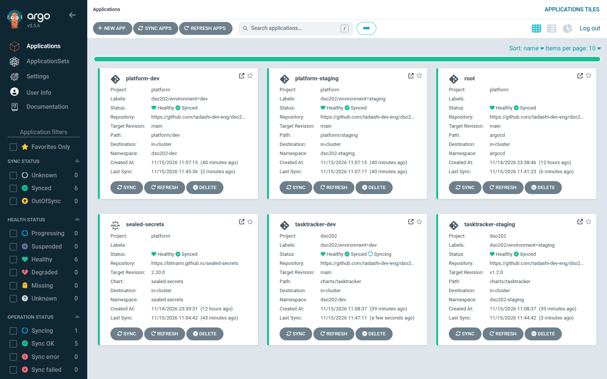
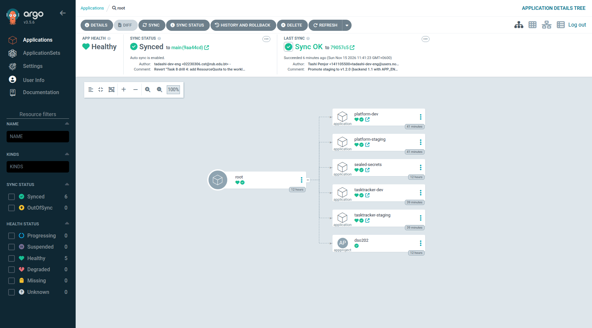
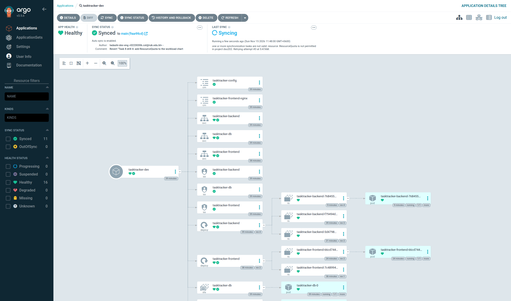
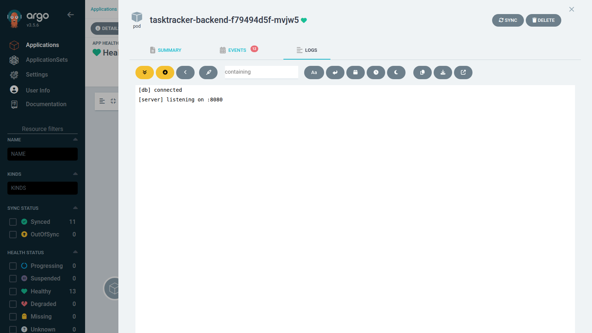

<!--
=============================================================================
File        : docs/evidence.md
Assignment  : DSO202 Assignment 4
Purpose     : Command output for every task (section 9 evidence convention).
              Each block shows the command as typed and its output. Passwords
              are never shown: they are read from ../dso202-keys at run time.
=============================================================================
-->
# Evidence - DSO202 Assignment 4

Repository: `https://github.com/tadashi-dev-eng/dso202-gitops.git` -
Cluster: kind `dso202-gitops` - Argo CD API reached with
`kubectl port-forward svc/argocd-server -n argocd 8443:443` (port 8080 is taken by Jenkins).

## Task 1 - Repository, chart contract and cluster

### Tool check (section 3.2)

```text
$ docker version --format '{{.Server.Version}}'
29.2.1
$ kind version
kind v0.20.0 go1.20.4 linux/amd64
$ kubectl version --client
Client Version: v1.36.3
Kustomize Version: v5.8.1
$ helm version --short
v4.3.1+gc0d08d0
$ git --version
git version 2.48.1
$ argocd version --client
argocd: v3.5.6+c2b1e30
  BuildDate: 2026-10-20T19:01:52Z
  GitCommit: c2b1e3017e2cec86b122172e861dcd026453ae44
  GitTreeState: clean
  GoVersion: go1.26.10
  Compiler: gc
  Platform: linux/amd64
$ kubeseal --version
kubeseal version: 0.40.0
$ helm repo add sealed-secrets https://bitnami.github.io/sealed-secrets
"sealed-secrets" already exists with the same configuration, skipping
$ helm repo update sealed-secrets
Hang tight while we grab the latest from your chart repositories...
...Successfully got an update from the "sealed-secrets" chart repository
Update Complete. ⎈Happy Helming!⎈
$ helm search repo sealed-secrets/sealed-secrets --versions | head -5
NAME                         	CHART VERSION	APP VERSION	DESCRIPTION                                  
sealed-secrets/sealed-secrets	2.22.0       	0.41.2     	Helm chart for the sealed-secrets controller.
sealed-secrets/sealed-secrets	2.21.0       	0.41.2     	Helm chart for the sealed-secrets controller.
sealed-secrets/sealed-secrets	2.20.0       	0.40.0     	Helm chart for the sealed-secrets controller.
sealed-secrets/sealed-secrets	2.19.3       	0.39.1     	Helm chart for the sealed-secrets controller.
```

### Chart contract

| # | Requirement | Where it is satisfied |
|---|---|---|
| C1 | Image repository and tag are values per tier | `values.yaml` `frontend/backend/database.image.{repository,tag}`; templates use `tasktracker.image` (`_helpers.tpl`), which `required`s both |
| C2 | Per-tier env from values | `backend.env` / `frontend.env` / `database.env` rendered by `tasktracker.env`; used in Task 7 for `APP_ENV` |
| C3 | No Secret rendered; `existingSecret` | `values.yaml` `existingSecret: tasktracker-credentials`; `secretKeyRef` in `backend.yaml` / `database.yaml`; `tasktracker.secretName` is `required` |
| C4 | Readiness probes on all tiers | backend `GET /api/status` (`backend.yaml`), frontend HTTP probe (`frontend.yaml`), database `pg_isready` (`database.yaml`) |
| C5 | Sync waves db 0, backend 1, frontend 2 | `argocd.argoproj.io/sync-wave` on the Service + workload in `database.yaml`, `backend.yaml`, `frontend.yaml` |
| C6 | `progressDeadlineSeconds: 120` | `values.yaml` `backend/frontend.progressDeadlineSeconds`, rendered in both Deployments |
| C7 | Requests and limits everywhere | `*.resources` in `values.yaml`; smoke-test Job has its own (`smoke-test-job.yaml`) |
| C8 | No Namespace/Quota/LimitRange/Role/RoleBinding | none in `templates/` (kinds listed below); they live in `platform/<env>/` |
| C9 | Ingress disabled by default | the chart has no Ingress template; nginx in the frontend Pod proxies `/api` (`frontend-nginx.yaml`) |
| C10 | Frontend NodePort as a value | `frontend.service.type: NodePort`, `nodePort` 30080 (`environments/dev`) / 30081 (`environments/staging`) |
| C11 | `helm lint` / `helm template` clean | output below |

### Lint and rendered kinds

```text
$ helm lint charts/tasktracker -f environments/dev/values.yaml
==> Linting charts/tasktracker
[INFO] Chart.yaml: icon is recommended

1 chart(s) linted, 0 chart(s) failed
$ helm lint charts/tasktracker -f environments/staging/values.yaml
==> Linting charts/tasktracker
[INFO] Chart.yaml: icon is recommended

1 chart(s) linted, 0 chart(s) failed
$ helm template tasktracker charts/tasktracker -f environments/dev/values.yaml | grep '^kind:' | sort | uniq -c
      2 kind: ConfigMap
      2 kind: Deployment
      3 kind: Service
      3 kind: ServiceAccount
      1 kind: StatefulSet
$ helm template tasktracker charts/tasktracker -f environments/staging/values.yaml | grep '^kind:' | sort | uniq -c
      2 kind: ConfigMap
      2 kind: Deployment
      3 kind: Service
      3 kind: ServiceAccount
      1 kind: StatefulSet
```

### Cluster

```text
$ kind get clusters
dso202
taskflow
$ kind delete cluster --name dso202
Deleting cluster "dso202" ...
Deleted nodes: ["dso202-control-plane" "dso202-worker2" "dso202-worker"]
$ kind create cluster --name dso202-gitops --config cluster/kind-cluster.yaml
Creating cluster "dso202-gitops" ...
 • Ensuring node image (kindest/node:v1.36.1) 🖼  ...
 ✓ Ensuring node image (kindest/node:v1.36.1) 🖼
 • Preparing nodes 📦 📦 📦   ...
 ✓ Preparing nodes 📦 📦 📦 
 • Writing configuration 📜  ...
 ✓ Writing configuration 📜
 • Starting control-plane 🕹️  ...
 ✓ Starting control-plane 🕹️
 • Installing CNI 🔌  ...
 ✓ Installing CNI 🔌
 • Installing StorageClass 💾  ...
 ✓ Installing StorageClass 💾
 • Joining worker nodes 🚜  ...
 ✓ Joining worker nodes 🚜
Set kubectl context to "kind-dso202-gitops"
You can now use your cluster with:

kubectl cluster-info --context kind-dso202-gitops

Have a question, bug, or feature request? Let us know! https://kind.sigs.k8s.io/#community 🙂
$ kubectl config current-context
kind-dso202-gitops
$ kubectl get nodes
NAME            STATUS     ROLES           AGE   VERSION
control-plane   NotReady   control-plane   12s   v1.36.1
worker-node-1   NotReady   <none>          1s    v1.36.1
worker-node-2   NotReady   <none>          1s    v1.36.1
$ docker ps --filter name=dso202-gitops --format '{{.Names}}   {{.Ports}}'
dso202-gitops-worker   
dso202-gitops-control-plane   127.0.0.1:30080->30080/tcp, 127.0.0.1:46645->6443/tcp
dso202-gitops-worker2   
```

## Task 2 - Install Argo CD declaratively

```text
$ kubectl kustomize bootstrap/argocd | grep -E '^kind: (Deployment|StatefulSet)$' | sort | uniq -c
      6 kind: Deployment
      1 kind: StatefulSet
$ kubectl kustomize bootstrap/argocd | grep 'image:' | sort -u
        image: ghcr.io/dexidp/dex:v2.45.1
        image: public.ecr.aws/docker/library/redis:8.2.3-alpine
        image: quay.io/argoproj/argocd:v3.5.6
$ kubectl apply -k bootstrap/argocd --server-side --force-conflicts | tail -8
statefulset.apps/argocd-application-controller serverside-applied
networkpolicy.networking.k8s.io/argocd-application-controller-network-policy serverside-applied
networkpolicy.networking.k8s.io/argocd-applicationset-controller-network-policy serverside-applied
networkpolicy.networking.k8s.io/argocd-dex-server-network-policy serverside-applied
networkpolicy.networking.k8s.io/argocd-notifications-controller-network-policy serverside-applied
networkpolicy.networking.k8s.io/argocd-redis-network-policy serverside-applied
networkpolicy.networking.k8s.io/argocd-repo-server-network-policy serverside-applied
networkpolicy.networking.k8s.io/argocd-server-network-policy serverside-applied
$ kubectl wait --for=condition=Available deployment --all -n argocd --timeout=500s
deployment.apps/argocd-applicationset-controller condition met
deployment.apps/argocd-dex-server condition met
deployment.apps/argocd-notifications-controller condition met
deployment.apps/argocd-redis condition met
deployment.apps/argocd-repo-server condition met
deployment.apps/argocd-server condition met
$ kubectl rollout status statefulset/argocd-application-controller -n argocd --timeout=300s
partitioned roll out complete: 1 new pods have been updated...
$ kubectl get pods -n argocd
NAME                                                READY   STATUS    RESTARTS   AGE
argocd-application-controller-0                     1/1     Running   0          3m7s
argocd-applicationset-controller-58bb5c7479-xjhkq   1/1     Running   0          3m7s
argocd-dex-server-dd6b85d9c-xrt4z                   1/1     Running   0          3m7s
argocd-notifications-controller-6b85c65458-chddn    1/1     Running   0          3m7s
argocd-redis-869b85489d-9t6s6                       1/1     Running   0          3m7s
argocd-repo-server-5bf66565cd-zch4v                 1/1     Running   0          3m7s
argocd-server-7474bb8f76-6j8wc                      1/1     Running   0          3m7s
$ kubectl get crd | grep argoproj.io
applications.argoproj.io      2026-11-14T17:28:10Z
applicationsets.argoproj.io   2026-11-14T17:28:10Z
appprojects.argoproj.io       2026-11-14T17:28:10Z
```

```text
$ argocd admin initial-password -n argocd | sed 's/^[^ ]\+/<redacted-initial-password>/'
<redacted-initial-password>

 This password must be only used for first time login. We strongly recommend you update the password using `argocd account update-password`.
$ argocd login localhost:8443 --username admin --password "$(cat ../dso202-keys/argocd-admin-initial.txt)" --insecure
'admin:login' logged in successfully
Context 'localhost:8443' updated
$ kubectl get configmap argocd-cm -n argocd -o yaml | grep -E 'timeout.reconciliation|accounts.reviewer'
  accounts.reviewer: login
  timeout.reconciliation: 60s
  timeout.reconciliation.jitter: 10s
$ argocd version
argocd: v3.5.6+c2b1e30
  BuildDate: 2026-10-20T19:01:52Z
  GitCommit: c2b1e3017e2cec86b122172e861dcd026453ae44
  GitTreeState: clean
  GoVersion: go1.26.10
  Compiler: gc
  Platform: linux/amd64
argocd-server: v3.5.6
  BuildDate: 2026-10-20T18:33:20Z
  GitCommit: c2b1e3017e2cec86b122172e861dcd026453ae44
  GitTreeState: clean
  GitTag: v3.5.6
  GoVersion: go1.26.10
  Compiler: gc
  Platform: linux/amd64
  Kustomize Version: v5.8.1 2026-02-09T16:15:27Z
  Helm Version: v4.2.1+gd591a19
  Kubectl Version: v0.36.1
  Jsonnet Version: v0.22.0
```

Argo CD UI after sign-in:



## Task 3 - AppProjects and the root Application

```text
$ kubectl apply -f bootstrap/root
appproject.argoproj.io/platform created
Warning: metadata.finalizers: "resources-finalizer.argocd.argoproj.io": prefer a domain-qualified finalizer name including a path (/) to avoid accidental conflicts with other finalizer writers
application.argoproj.io/root created
$ kubectl get appproject,application -n argocd
NAME                              AGE
appproject.argoproj.io/default    8m28s
appproject.argoproj.io/dso202     23s
appproject.argoproj.io/platform   30s

NAME                           SYNC STATUS   HEALTH STATUS
application.argoproj.io/root   Synced        Healthy
$ argocd app get root
Name:               argocd/root
Project:            platform
Server:             https://kubernetes.default.svc
Namespace:          argocd
URL:                https://localhost:8443/applications/root
Source:
- Repo:             https://github.com/tadashi-dev-eng/dso202-gitops.git
  Target:           main
  Path:             argocd
SyncWindow:         Sync Allowed
Sync Policy:        Automated (Prune)
Sync Status:        Synced to main (dd39fa2)
Health Status:      Healthy

GROUP        KIND        NAMESPACE  NAME    STATUS  HEALTH  HOOK  MESSAGE
argoproj.io  AppProject  argocd     dso202  Synced                appproject.argoproj.io/dso202 unchanged
$ argocd proj get dso202
Name:                        dso202
Description:                 Task Tracker workloads for the dev and staging environments
Destinations:                https://kubernetes.default.svc,dso202-dev
                             https://kubernetes.default.svc,dso202-staging
Repositories:                https://github.com/tadashi-dev-eng/dso202-gitops.git
Source Namespaces:           <none>
Scoped Repositories:         <none>
Allowed Cluster Resources:   <none>
Scoped Clusters:             <none>
Denied Namespaced Resources: <none>
Signature keys:              <none>
Orphaned Resources:          disabled
```

Final `dso202` whitelist: `apps/Deployment`, `apps/StatefulSet`, `Service`, `ConfigMap`,
`ServiceAccount`, `batch/Job` (exactly the kinds `helm template` renders, the Job being the
PostSync hook). In Task 6, `apps/ReplicaSet` and `Pod` were added with a comment in the file:
Argo CD drops non-permitted kinds from the resource tree, so Pods (and their logs) were invisible.

Root Application resource tree:



## Task 4 - Platform layer and Sealed Secrets

### Step 1-2: controller from Git, key backup

```text
$ kubectl get applications -n argocd
NAME             SYNC STATUS   HEALTH STATUS
root             Synced        Healthy
sealed-secrets   Synced        Healthy
$ kubectl get pods -n sealed-secrets
NAME                                        READY   STATUS    RESTARTS   AGE
sealed-secrets-controller-8b5ffdf69-7t8c2   1/1     Running   0          38s
$ kubectl get crd sealedsecrets.bitnami.com
NAME                        CREATED AT
sealedsecrets.bitnami.com   2026-11-15T05:04:40Z
$ mkdir -p ../dso202-keys
$ kubectl get secret -n sealed-secrets -l sealedsecrets.bitnami.com/sealed-secrets-key -o yaml > ../dso202-keys/sealing-key.backup.yaml
$ chmod 600 ../dso202-keys/sealing-key.backup.yaml
$ ls -l ../dso202-keys/
total 12
-rw------- 1 tadashi tadashi   17 Nov 14 23:31 argocd-admin-initial.txt
-rw------- 1 tadashi tadashi 7087 Nov 15 11:05 sealing-key.backup.yaml
```

### Step 4: sealing (plaintext only in git-ignored `secrets-plain/`)

```text
$ export SEALED_SECRETS_CONTROLLER_NAMESPACE=sealed-secrets
for env in dev staging; do
  kubectl create secret generic tasktracker-credentials --namespace dso202-$env --from-env-file=secrets-plain/$env.env --dry-run=client -o yaml | kubeseal --format yaml > platform/$env/tasktracker-credentials.sealed.yaml
done
$ ls -l platform/dev platform/staging
platform/dev:
total 12
-rw-rw-r-- 1 tadashi tadashi 1620 Nov 14 23:22 quota-and-limits.yaml
-rw-rw-r-- 1 tadashi tadashi 1545 Nov 14 23:22 rbac.yaml
-rw-rw-r-- 1 tadashi tadashi 3271 Nov 15 11:05 tasktracker-credentials.sealed.yaml

platform/staging:
total 12
-rw-rw-r-- 1 tadashi tadashi 1640 Nov 14 23:22 quota-and-limits.yaml
-rw-rw-r-- 1 tadashi tadashi 1569 Nov 14 23:22 rbac.yaml
-rw-rw-r-- 1 tadashi tadashi 3287 Nov 15 11:05 tasktracker-credentials.sealed.yaml
$ grep -E "^kind|name:|namespace:|DB_|POSTGRES_" platform/dev/tasktracker-credentials.sealed.yaml | cut -c1-90
kind: SealedSecret
  name: tasktracker-credentials
  namespace: dso202-dev
    DB_PASSWORD: AgCbVd6DOsvS6rgshAMezxID0h5ZC50mrsgyFgouMoJvMt+QFSmFO2SkVy0GsIyzLUBfv90Qm
    DB_USER: AgBD6IexkxeHY9dsV2Goq/nMJKnnf2scGe6Ij98ylRqFST5dpgPVi2Lp49t1rfSbUMrNX/f3rAi6H
    POSTGRES_PASSWORD: AgCqAbaJ5I/cCv28DDb2YRhIHHLrJoD9p73lml4/JZ3OpQ2qBV1PlhhFYcx6XNI1ItJ
    POSTGRES_USER: AgCCwLHtc0JRMemcurvH78K5VGB1t4/lhb5sYyMsgy3FcAnWEiOhONf+b45g4wnO7H5CKJP
      name: tasktracker-credentials
      namespace: dso202-dev
```

### Step 6: platform Applications, namespaces, Secrets, quota

```text
$ kubectl get applications -n argocd
NAME               SYNC STATUS   HEALTH STATUS
platform-dev       Synced        Healthy
platform-staging   Synced        Healthy
root               Synced        Healthy
sealed-secrets     Synced        Healthy
$ kubectl get namespaces | grep dso202
dso202-dev           Active   9s
dso202-staging       Active   9s
$ kubectl get sealedsecret -n dso202-dev
NAME                      STATUS   SYNCED   AGE
tasktracker-credentials            True     8s
$ kubectl get sealedsecret -n dso202-staging
NAME                      STATUS   SYNCED   AGE
tasktracker-credentials            True     8s
$ kubectl describe secret tasktracker-credentials -n dso202-dev
Name:         tasktracker-credentials
Namespace:    dso202-dev
Labels:       <none>
Annotations:  <none>

Type:  Opaque

Data
====
DB_PASSWORD:        32 bytes
DB_USER:            15 bytes
POSTGRES_PASSWORD:  32 bytes
POSTGRES_USER:      15 bytes
$ kubectl describe secret tasktracker-credentials -n dso202-staging | tail -7

Data
====
DB_PASSWORD:        32 bytes
DB_USER:            19 bytes
POSTGRES_PASSWORD:  32 bytes
POSTGRES_USER:      19 bytes
$ kubectl get resourcequota,limitrange -n dso202-dev
NAME                     REQUEST                                                                                                                                                                            LIMIT                                   AGE
resourcequota/ns-quota   persistentvolumeclaims: 0/2, pods: 0/10, requests.cpu: 0/1, requests.memory: 0/1Gi, requests.storage: 0/2Gi, services: 0/4, services.loadbalancers: 0/0, services.nodeports: 0/1   limits.cpu: 0/3, limits.memory: 0/2Gi   9s

NAME                   CREATED AT
limitrange/ns-limits   2026-11-15T05:07:17Z
$ kubectl get resourcequota,limitrange,role,rolebinding -n dso202-staging
NAME                     REQUEST                                                                                                                                                                            LIMIT                                   AGE
resourcequota/ns-quota   persistentvolumeclaims: 0/2, pods: 0/10, requests.cpu: 0/1, requests.memory: 0/1Gi, requests.storage: 0/2Gi, services: 0/4, services.loadbalancers: 0/0, services.nodeports: 0/1   limits.cpu: 0/3, limits.memory: 0/2Gi   9s

NAME                   CREATED AT
limitrange/ns-limits   2026-11-15T05:07:17Z

NAME                                        CREATED AT
role.rbac.authorization.k8s.io/app-reader   2026-11-15T05:07:17Z

NAME                                                       ROLE              AGE
rolebinding.rbac.authorization.k8s.io/app-viewer-binding   Role/app-reader   9s
```

### Step 7: no plaintext in history (keys tested: DB_USER, DB_PASSWORD per environment; POSTGRES_* carry the same values)

```text
$ for env in dev staging; do
  for key in DB_USER DB_PASSWORD; do            # POSTGRES_* carry the same values
    value=$(grep "^$key=" secrets-plain/$env.env | cut -d= -f2-)
    hits=$(git log -p --all -S"$value" | head | wc -l)
    echo "$env $key: git log -p --all -S<value> | head  -> $hits lines"
  done
done
dev DB_USER: git log -p --all -S<value> | head  -> 0 lines
dev DB_PASSWORD: git log -p --all -S<value> | head  -> 0 lines
staging DB_USER: git log -p --all -S<value> | head  -> 0 lines
staging DB_PASSWORD: git log -p --all -S<value> | head  -> 0 lines
$ git status --short --ignored
!! secrets-plain/
$ install -m 600 secrets-plain/dev.env ../dso202-keys/credentials-dev.env; install -m 600 secrets-plain/staging.env ../dso202-keys/credentials-staging.env; rm secrets-plain/*.env
$ ls -l ../dso202-keys/
total 20
-rw------- 1 tadashi tadashi   17 Nov 14 23:31 argocd-admin-initial.txt
-rw------- 1 tadashi tadashi  150 Nov 15 11:07 credentials-dev.env
-rw------- 1 tadashi tadashi  158 Nov 15 11:07 credentials-staging.env
-rw------- 1 tadashi tadashi 7087 Nov 15 11:05 sealing-key.backup.yaml
```

## Task 5 - Workloads in dev and staging

### Dev: wave order (db -> backend -> frontend -> PostSync smoke test)

```text
$ kubectl get pods -n dso202-dev -w --output-watch-events
EVENT      NAME               READY   STATUS    RESTARTS   AGE
ADDED      tasktracker-db-0   0/1     Pending   0          0s
MODIFIED   tasktracker-db-0   0/1     Running             0          8s
MODIFIED   tasktracker-db-0   1/1     Running             0          35s
ADDED      tasktracker-backend-f79494d5f-mvjw5   0/1     Pending             0          0s
MODIFIED   tasktracker-backend-f79494d5f-mvjw5   0/1     Running             0          1s
MODIFIED   tasktracker-backend-f79494d5f-mvjw5   1/1     Running             0          47s
ADDED      tasktracker-frontend-7c4899464b-gqlrc   0/1     Pending             0          0s
MODIFIED   tasktracker-frontend-7c4899464b-gqlrc   0/1     Running             0          1s
MODIFIED   tasktracker-frontend-7c4899464b-gqlrc   1/1     Running             0          7s
ADDED      tasktracker-smoke-test-72hfc            0/1     Pending             0          0s
MODIFIED   tasktracker-smoke-test-72hfc            1/1     Running             0          3s
MODIFIED   tasktracker-smoke-test-72hfc            0/1     Completed           0          4s
MODIFIED   tasktracker-smoke-test-72hfc            0/1     Completed           0          5s
MODIFIED   tasktracker-smoke-test-72hfc            0/1     Completed           0          6s
^C
$ kubectl get job -n dso202-dev
NAME                     STATUS     COMPLETIONS   DURATION   AGE
tasktracker-smoke-test   Complete   1/1           6s         24s
$ kubectl logs job/tasktracker-smoke-test -n dso202-dev
[{"id":1,"title":"Set up kind cluster","description":"Bring up the local cluster from Practical 1","status":"done","created_at":"2026-11-15T05:09:09.635Z"},{"id":2,"title":"Write namespace manifest","description":"One namespace for all assignment resources","status":"in_progress","created_at":"2026-11-15T05:09:09.635Z"},{"id":3,"title":"Wire ConfigMap and Secret","description":"DB_* and POSTGRES_* must carry matching values","status":"pending","created_at":"2026-11-15T05:09:09.635Z"}]
smoke test passed on attempt 1
$ argocd app get tasktracker-dev
Name:               argocd/tasktracker-dev
Project:            dso202
Server:             https://kubernetes.default.svc
Namespace:          dso202-dev
URL:                https://localhost:8443/applications/tasktracker-dev
Source:
- Repo:             https://github.com/tadashi-dev-eng/dso202-gitops.git
  Target:           main
  Path:             charts/tasktracker
  Helm Values:      ../../environments/dev/values.yaml
SyncWindow:         Sync Allowed
Sync Policy:        Automated (Prune)
Sync Status:        Synced to main (2167a8a)
Health Status:      Healthy

GROUP  KIND            NAMESPACE   NAME                        STATUS     HEALTH   HOOK      MESSAGE
       ServiceAccount  dso202-dev  tasktracker-backend         Synced                        serviceaccount/tasktracker-backend created
       ServiceAccount  dso202-dev  tasktracker-db              Synced                        serviceaccount/tasktracker-db created
       ServiceAccount  dso202-dev  tasktracker-frontend        Synced                        serviceaccount/tasktracker-frontend created
       ConfigMap       dso202-dev  tasktracker-config          Synced                        configmap/tasktracker-config created
       ConfigMap       dso202-dev  tasktracker-frontend-nginx  Synced                        configmap/tasktracker-frontend-nginx created
       Service         dso202-dev  tasktracker-db              Synced     Healthy            service/tasktracker-db created
apps   StatefulSet     dso202-dev  tasktracker-db              Synced     Healthy            statefulset rolling update complete 1 pods at revision tasktracker-db-57d4c4bf4c...
       Service         dso202-dev  tasktracker-backend         Synced     Healthy            service/tasktracker-backend created
apps   Deployment      dso202-dev  tasktracker-backend         Synced     Healthy            deployment.apps/tasktracker-backend created
       Service         dso202-dev  tasktracker-frontend        Synced     Healthy            service/tasktracker-frontend created
apps   Deployment      dso202-dev  tasktracker-frontend        Synced     Healthy            deployment.apps/tasktracker-frontend created
batch  Job             dso202-dev  tasktracker-smoke-test      Succeeded  Synced   PostSync  Reached expected number of succeeded pods
```

### CRUD cycle in dev

```text
$ curl -s -o /dev/null -w "frontend HTTP %{http_code}\n" http://localhost:30080/
frontend HTTP 200
$ curl -s -X POST -H "Content-Type: application/json" -d "{\"title\":\"A4 GitOps demo\",\"description\":\"created through http://localhost:30080\",\"status\":\"pending\"}" http://localhost:30080/api/tasks; echo
{"id":5,"title":"A4 GitOps demo","description":"created through http://localhost:30080","status":"pending","created_at":"2026-11-15T05:10:51.080Z"}
$ curl -s http://localhost:30080/api/tasks/5; echo
{"id":5,"title":"A4 GitOps demo","description":"created through http://localhost:30080","status":"pending","created_at":"2026-11-15T05:10:51.080Z"}
$ curl -s -X PUT -H "Content-Type: application/json" -d "{\"title\":\"A4 GitOps demo\",\"description\":\"updated\",\"status\":\"done\"}" http://localhost:30080/api/tasks/5; echo
{"id":5,"title":"A4 GitOps demo","description":"updated","status":"done","created_at":"2026-11-15T05:10:51.080Z"}
$ curl -s -X DELETE -o /dev/null -w "DELETE HTTP %{http_code}\n" http://localhost:30080/api/tasks/5
DELETE HTTP 204
$ curl -s http://localhost:30080/api/tasks/5 -w "\nGET after delete HTTP %{http_code}\n"
{"error":"task not found"}
GET after delete HTTP 404
```

### Staging: before and after the first manual sync (root state recorded both times)

```text
$ kubectl get applications -n argocd
NAME                  SYNC STATUS   HEALTH STATUS
platform-dev          Synced        Healthy
platform-staging      Synced        Healthy
root                  Synced        Healthy
sealed-secrets        Synced        Healthy
tasktracker-dev       Synced        Healthy
tasktracker-staging   OutOfSync     Missing
$ argocd app get root | sed -n "/^Sync Status/,/^Health/p"
Sync Status:        Synced to main (2167a8a)
Health Status:      Healthy
$ argocd app get tasktracker-staging
Name:               argocd/tasktracker-staging
Project:            dso202
Server:             https://kubernetes.default.svc
Namespace:          dso202-staging
URL:                https://localhost:8443/applications/tasktracker-staging
Source:
- Repo:             https://github.com/tadashi-dev-eng/dso202-gitops.git
  Target:           v1.0.0
  Path:             charts/tasktracker
  Helm Values:      ../../environments/staging/values.yaml
SyncWindow:         Sync Allowed
Sync Policy:        Manual
Sync Status:        OutOfSync from v1.0.0 (ebed13c)
Health Status:      Missing

GROUP  KIND            NAMESPACE       NAME                        STATUS     HEALTH   HOOK  MESSAGE
       ConfigMap       dso202-staging  tasktracker-config          OutOfSync  Missing        
       ConfigMap       dso202-staging  tasktracker-frontend-nginx  OutOfSync  Missing        
       Service         dso202-staging  tasktracker-backend         OutOfSync  Missing        
       Service         dso202-staging  tasktracker-db              OutOfSync  Missing        
       Service         dso202-staging  tasktracker-frontend        OutOfSync  Missing        
       ServiceAccount  dso202-staging  tasktracker-backend         OutOfSync  Missing        
       ServiceAccount  dso202-staging  tasktracker-db              OutOfSync  Missing        
       ServiceAccount  dso202-staging  tasktracker-frontend        OutOfSync  Missing        
apps   Deployment      dso202-staging  tasktracker-backend         OutOfSync  Missing        
apps   Deployment      dso202-staging  tasktracker-frontend        OutOfSync  Missing        
apps   StatefulSet     dso202-staging  tasktracker-db              OutOfSync  Missing        
$ argocd app sync tasktracker-staging --timeout 300 | tail -16
Duration:           1m38s
Message:            successfully synced (no more tasks)

GROUP  KIND            NAMESPACE       NAME                        STATUS     HEALTH   HOOK      MESSAGE
       ServiceAccount  dso202-staging  tasktracker-frontend        Synced                        serviceaccount/tasktracker-frontend created
       ServiceAccount  dso202-staging  tasktracker-backend         Synced                        serviceaccount/tasktracker-backend created
       ServiceAccount  dso202-staging  tasktracker-db              Synced                        serviceaccount/tasktracker-db created
       ConfigMap       dso202-staging  tasktracker-config          Synced                        configmap/tasktracker-config created
       ConfigMap       dso202-staging  tasktracker-frontend-nginx  Synced                        configmap/tasktracker-frontend-nginx created
       Service         dso202-staging  tasktracker-db              Synced     Healthy            service/tasktracker-db created
apps   StatefulSet     dso202-staging  tasktracker-db              Synced     Healthy            statefulset rolling update complete 1 pods at revision tasktracker-db-6f76fcc4d9...
       Service         dso202-staging  tasktracker-backend         Synced     Healthy            service/tasktracker-backend created
apps   Deployment      dso202-staging  tasktracker-backend         Synced     Healthy            deployment.apps/tasktracker-backend created
       Service         dso202-staging  tasktracker-frontend        Synced     Healthy            service/tasktracker-frontend created
apps   Deployment      dso202-staging  tasktracker-frontend        Synced     Healthy            deployment.apps/tasktracker-frontend created
batch  Job             dso202-staging  tasktracker-smoke-test      Succeeded  Synced   PostSync  Reached expected number of succeeded pods
$ argocd app get root | sed -n "/^Sync Status/,\$p"
Sync Status:        Synced to main (2167a8a)
Health Status:      Healthy

GROUP        KIND         NAMESPACE  NAME                 STATUS  HEALTH   HOOK  MESSAGE
argoproj.io  AppProject   argocd     dso202               Synced                 appproject.argoproj.io/dso202 unchanged
argoproj.io  Application  argocd     sealed-secrets       Synced  Healthy        application.argoproj.io/sealed-secrets unchanged
argoproj.io  Application  argocd     platform-dev         Synced  Healthy        application.argoproj.io/platform-dev unchanged
argoproj.io  Application  argocd     platform-staging     Synced  Healthy        application.argoproj.io/platform-staging unchanged
argoproj.io  Application  argocd     tasktracker-dev      Synced  Healthy        application.argoproj.io/tasktracker-dev created
argoproj.io  Application  argocd     tasktracker-staging  Synced  Healthy        application.argoproj.io/tasktracker-staging created
$ kubectl get applications -n argocd
NAME                  SYNC STATUS   HEALTH STATUS
platform-dev          Synced        Healthy
platform-staging      Synced        Healthy
root                  Synced        Healthy
sealed-secrets        Synced        Healthy
tasktracker-dev       Synced        Healthy
tasktracker-staging   Synced        Healthy
$ kubectl get svc -n dso202-staging
NAME                   TYPE        CLUSTER-IP      EXTERNAL-IP   PORT(S)          AGE
tasktracker-backend    ClusterIP   10.96.67.198    <none>        8080/TCP         83s
tasktracker-db         ClusterIP   None            <none>        5432/TCP         114s
tasktracker-frontend   NodePort    10.96.150.227   <none>        8080:30081/TCP   41s
$ kubectl logs job/tasktracker-smoke-test -n dso202-staging | tail -1
smoke test passed on attempt 1
$ kubectl port-forward -n dso202-staging svc/tasktracker-frontend 8081:8080 &
Forwarding from 127.0.0.1:8081 -> 8080
Forwarding from [::1]:8081 -> 8080
$ curl -s -o /dev/null -w "staging frontend HTTP %{http_code}\n" http://localhost:8081/
staging frontend HTTP 200
$ curl -s http://localhost:8081/api/status; echo
{"status":"ok","db":"connected"}
```

`tasktracker-dev` resource tree:



## Task 6 - Access control

```text
$ argocd account list
NAME      ENABLED  CAPABILITIES
admin     true     login
reviewer  true     login
$ argocd account update-password --account reviewer --current-password "$(cat ../dso202-keys/argocd-admin-initial.txt)" --new-password "$(cat ../dso202-keys/argocd-reviewer-password.txt)"
Password updated
$ argocd login localhost:8443 --username reviewer --password "$(cat ../dso202-keys/argocd-reviewer-password.txt)" --insecure --name reviewer
'reviewer:login' logged in successfully
Context 'reviewer' updated
$ argocd --argocd-context reviewer app list
NAME                        CLUSTER                         NAMESPACE       PROJECT  STATUS  HEALTH   SYNCPOLICY  CONDITIONS  REPO                                                  PATH                TARGET
argocd/tasktracker-dev      https://kubernetes.default.svc  dso202-dev      dso202   Synced  Healthy  Auto-Prune  <none>      https://github.com/tadashi-dev-eng/dso202-gitops.git  charts/tasktracker  main
argocd/tasktracker-staging  https://kubernetes.default.svc  dso202-staging  dso202   Synced  Healthy  Manual      <none>      https://github.com/tadashi-dev-eng/dso202-gitops.git  charts/tasktracker  v1.0.0
$ argocd --argocd-context reviewer account can-i get applications 'dso202/tasktracker-dev'
yes
$ argocd --argocd-context reviewer account can-i sync applications 'dso202/tasktracker-dev'
no
$ argocd --argocd-context reviewer account can-i get logs 'dso202/tasktracker-dev'
no
$ argocd --argocd-context reviewer proj get platform
{"level":"fatal","msg":"rpc error: code = PermissionDenied desc = permission denied: projects, get, platform, sub: reviewer, iat: 2026-11-15T05:15:28Z","time":"2026-11-15T11:15:30+06:00"}
$ argocd --argocd-context reviewer app sync tasktracker-dev
{"level":"fatal","msg":"rpc error: code = PermissionDenied desc = permission denied: applications, sync, dso202/tasktracker-dev, sub: reviewer, iat: 2026-11-15T05:15:28Z","time":"2026-11-15T11:15:30+06:00"}
```

### Step 4-5: logs rule added by commit, bootstrap re-applied, admin context restored

```text
$ git log --oneline -1
574ac74 Task 6: grant reviewer read access to logs in dso202 (Argo CD 3.x separate logs resource)
$ git show --stat --format= HEAD
 bootstrap/argocd/argocd-rbac-cm-patch.yaml | 6 +++---
 1 file changed, 3 insertions(+), 3 deletions(-)
$ kubectl apply -k bootstrap/argocd --server-side --force-conflicts | grep -E "argocd-rbac-cm|argocd-cm "
configmap/argocd-cm serverside-applied
configmap/argocd-rbac-cm serverside-applied
$ kubectl get configmap argocd-rbac-cm -n argocd -o jsonpath="{.data.policy\.csv}" | grep "^p,"
p, reviewer, applications, get, dso202/*, allow
p, reviewer, projects, get, dso202, allow
p, reviewer, logs, get, dso202/*, allow
$ argocd --argocd-context reviewer account can-i get logs 'dso202/tasktracker-dev'
yes
$ argocd context
CURRENT  NAME            SERVER
         localhost:8443  localhost:8443
*        reviewer        localhost:8443
$ argocd login localhost:8443 --username admin --password "$(cat ../dso202-keys/argocd-admin-initial.txt)" --insecure
'admin:login' logged in successfully
Context 'localhost:8443' updated
$ argocd context
CURRENT  NAME            SERVER
*        localhost:8443  localhost:8443
         reviewer        localhost:8443
$ kubectl get appproject dso202 -n argocd -o jsonpath="{range .spec.namespaceResourceWhitelist[*]}{.group}/{.kind}{\"\\n\"}{end}"
apps/Deployment
apps/StatefulSet
/Service
/ConfigMap
/ServiceAccount
batch/Job
apps/ReplicaSet
/Pod
$ argocd --argocd-context reviewer account can-i get logs 'dso202/tasktracker-dev'
yes
$ argocd --argocd-context reviewer app logs tasktracker-dev --group apps --kind Deployment --name tasktracker-backend --tail 4
[db] connected
[server] listening on :8080
$ argocd --argocd-context reviewer app logs tasktracker-staging --group apps --kind Deployment --name tasktracker-backend --tail 2
```

`reviewer` session showing Pod logs:



## Task 7 - Release, faulty release, recovery

### Part A: frontend 1.1 in dev (PR #1)

```text
$ kubectl get pods -n dso202-dev -w
NAME                                    READY   STATUS      RESTARTS   AGE
tasktracker-backend-f79494d5f-mvjw5     1/1     Running     0          13m
tasktracker-db-0                        1/1     Running     0          14m
tasktracker-frontend-7c4899464b-gqlrc   1/1     Running     0          12m
tasktracker-smoke-test-72hfc            0/1     Completed   0          12m
tasktracker-frontend-66cd7444d7-ccr9g   0/1     Running             0          3s
tasktracker-frontend-66cd7444d7-ccr9g   1/1     Running             0          14s
tasktracker-frontend-7c4899464b-gqlrc   1/1     Terminating         0          13m
tasktracker-smoke-test-72hfc            0/1     Completed           0          13m
tasktracker-frontend-7c4899464b-gqlrc   0/1     Completed           0          14m
tasktracker-smoke-test-kh58s            1/1     Running             0          6s
tasktracker-smoke-test-kh58s            0/1     Completed           0          7s
tasktracker-smoke-test-kh58s            0/1     Completed           0          8s
tasktracker-smoke-test-kh58s            0/1     Completed           0          9s
^C
$ argocd app get tasktracker-dev | sed -n "/^Sync Status/,/^Health/p"
Sync Status:        Synced to main (ab2131e)
Health Status:      Healthy
$ argocd app history tasktracker-dev
SOURCE  https://github.com/tadashi-dev-eng/dso202-gitops.git
ID      DATE                           REVISION
0       2026-11-15 11:10:19 +0600 +06  main (2167a8a)
1       2026-11-15 11:24:10 +0600 +06  main (ab2131e)
$ kubectl get deploy tasktracker-frontend -n dso202-dev -o jsonpath="{.spec.template.spec.containers[0].image}{\"\\n\"}"
sarojsanyasi/dso202-frontend:1.1
$ kubectl logs job/tasktracker-smoke-test -n dso202-dev | tail -1
smoke test passed on attempt 1
$ curl -s http://localhost:30080/ | grep -o -i -E "release[^<]{0,30}|v?1\.1[^<]{0,20}" | head -3
release">v1.1
```

### Part A: promotion through tag v1.1.0 (PR #2) and manual sync

```text
$ git tag -n1
v1.0.0          Baseline release: images 1.0
v1.1.0          Release: frontend 1.1
$ argocd app get tasktracker-staging
Name:               argocd/tasktracker-staging
Project:            dso202
Server:             https://kubernetes.default.svc
Namespace:          dso202-staging
URL:                https://localhost:8443/applications/tasktracker-staging
Source:
- Repo:             https://github.com/tadashi-dev-eng/dso202-gitops.git
  Target:           v1.1.0
  Path:             charts/tasktracker
  Helm Values:      ../../environments/staging/values.yaml
SyncWindow:         Sync Allowed
Sync Policy:        Manual
Sync Status:        OutOfSync from v1.1.0 (ab2131e)
Health Status:      Healthy

GROUP  KIND            NAMESPACE       NAME                        STATUS     HEALTH   HOOK      MESSAGE
       ServiceAccount  dso202-staging  tasktracker-frontend        Synced                        serviceaccount/tasktracker-frontend created
       ServiceAccount  dso202-staging  tasktracker-backend         Synced                        serviceaccount/tasktracker-backend created
       ServiceAccount  dso202-staging  tasktracker-db              Synced                        serviceaccount/tasktracker-db created
       ConfigMap       dso202-staging  tasktracker-config          Synced                        configmap/tasktracker-config created
       ConfigMap       dso202-staging  tasktracker-frontend-nginx  Synced                        configmap/tasktracker-frontend-nginx created
       Service         dso202-staging  tasktracker-db              Synced     Healthy            service/tasktracker-db created
apps   StatefulSet     dso202-staging  tasktracker-db              Synced     Healthy            statefulset rolling update complete 1 pods at revision tasktracker-db-6f76fcc4d9...
       Service         dso202-staging  tasktracker-backend         Synced     Healthy            service/tasktracker-backend created
apps   Deployment      dso202-staging  tasktracker-backend         Synced     Healthy            deployment.apps/tasktracker-backend created
       Service         dso202-staging  tasktracker-frontend        Synced     Healthy            service/tasktracker-frontend created
apps   Deployment      dso202-staging  tasktracker-frontend        OutOfSync  Healthy            deployment.apps/tasktracker-frontend created
batch  Job             dso202-staging  tasktracker-smoke-test      Succeeded  Synced   PostSync  Reached expected number of succeeded pods
$ curl -s http://localhost:8081/ | grep -c "v1.1"   # 0 = staging still serves the old header
0
$ argocd app sync tasktracker-staging --timeout 300 | sed -n "/^Sync Status/,/^Message/p"
Sync Status:        Synced to v1.1.0 (ab2131e)
Health Status:      Healthy

Operation:          Sync
Sync Revision:      ab2131eeede488d51c4fb9e6d32c806e174c5fba
Phase:              Succeeded
Start:              2026-11-15 11:25:44 +0600 +06
Finished:           2026-11-15 11:26:14 +0600 +06
Duration:           30s
Message:            successfully synced (no more tasks)
$ curl -s http://localhost:8081/ | grep -o "release\">v1.1"   # port-forward re-attached to the new frontend Pod
release">v1.1
$ argocd app history tasktracker-staging
SOURCE  https://github.com/tadashi-dev-eng/dso202-gitops.git
ID      DATE                           REVISION
0       2026-11-15 11:12:40 +0600 +06  v1.0.0 (ebed13c)
1       2026-11-15 11:26:14 +0600 +06  v1.1.0 (ab2131e)
```

### Part B step 4-5: backend 1.1 (PR #3, bad commit `9dc39a1`) - observed, not touched

```text
$ kubectl get pods -n dso202-dev -w
NAME                                    READY   STATUS      RESTARTS   AGE
tasktracker-backend-f79494d5f-mvjw5     1/1     Running     0          17m
tasktracker-db-0                        1/1     Running     0          18m
tasktracker-frontend-66cd7444d7-ccr9g   1/1     Running     0          3m17s
tasktracker-smoke-test-kh58s            0/1     Completed   0          3m3s
tasktracker-backend-5d47988c68-q2p98    0/1     Running             0          1s
tasktracker-backend-5d47988c68-q2p98    0/1     Error               0          12s
tasktracker-backend-5d47988c68-q2p98    0/1     Running             1 (2s ago)   13s
tasktracker-backend-5d47988c68-q2p98    0/1     Error               1 (10s ago)   21s
tasktracker-backend-5d47988c68-q2p98    0/1     CrashLoopBackOff    1 (12s ago)   33s
tasktracker-backend-5d47988c68-q2p98    0/1     Running             2 (13s ago)   34s
tasktracker-backend-5d47988c68-q2p98    0/1     Error               2 (24s ago)   45s
tasktracker-backend-5d47988c68-q2p98    0/1     CrashLoopBackOff    2 (23s ago)   67s
tasktracker-backend-5d47988c68-q2p98    0/1     Running             3 (23s ago)   67s
tasktracker-backend-5d47988c68-q2p98    0/1     Error               3 (33s ago)   77s
tasktracker-backend-5d47988c68-q2p98    0/1     CrashLoopBackOff    3 (55s ago)   2m11s
tasktracker-backend-5d47988c68-q2p98    0/1     Running             4 (55s ago)   2m11s
^C
$ argocd app get tasktracker-dev
Name:               argocd/tasktracker-dev
Project:            dso202
Server:             https://kubernetes.default.svc
Namespace:          dso202-dev
URL:                https://localhost:8443/applications/tasktracker-dev
Source:
- Repo:             https://github.com/tadashi-dev-eng/dso202-gitops.git
  Target:           main
  Path:             charts/tasktracker
  Helm Values:      ../../environments/dev/values.yaml
SyncWindow:         Sync Allowed
Sync Policy:        Automated (Prune)
Sync Status:        Synced to main (9dc39a1)
Health Status:      Degraded

GROUP  KIND            NAMESPACE   NAME                        STATUS  HEALTH    HOOK  MESSAGE
       ServiceAccount  dso202-dev  tasktracker-backend         Synced                  serviceaccount/tasktracker-backend unchanged
       ServiceAccount  dso202-dev  tasktracker-db              Synced                  serviceaccount/tasktracker-db unchanged
       ServiceAccount  dso202-dev  tasktracker-frontend        Synced                  serviceaccount/tasktracker-frontend unchanged
       ConfigMap       dso202-dev  tasktracker-config          Synced                  configmap/tasktracker-config unchanged
       ConfigMap       dso202-dev  tasktracker-frontend-nginx  Synced                  configmap/tasktracker-frontend-nginx unchanged
       Service         dso202-dev  tasktracker-db              Synced  Healthy         service/tasktracker-db unchanged
apps   StatefulSet     dso202-dev  tasktracker-db              Synced  Healthy         statefulset rolling update complete 1 pods at revision tasktracker-db-57d4c4bf4c...
       Service         dso202-dev  tasktracker-backend         Synced  Healthy         service/tasktracker-backend unchanged
apps   Deployment      dso202-dev  tasktracker-backend         Synced  Degraded        Deployment "tasktracker-backend" exceeded its progress deadline
       Service         dso202-dev  tasktracker-frontend        Synced  Healthy         
apps   Deployment      dso202-dev  tasktracker-frontend        Synced  Healthy         
batch  Job             dso202-dev  tasktracker-smoke-test              Healthy         
$ kubectl get applications -n argocd
NAME                  SYNC STATUS   HEALTH STATUS
platform-dev          Synced        Healthy
platform-staging      Synced        Healthy
root                  Synced        Degraded
sealed-secrets        Synced        Healthy
tasktracker-dev       Synced        Degraded
tasktracker-staging   Synced        Healthy
$ kubectl get job -n dso202-dev
NAME                     STATUS     COMPLETIONS   DURATION   AGE
tasktracker-smoke-test   Complete   1/1           9s         5m27s
$ curl -s -o /dev/null -w "dev frontend HTTP %{http_code}\n" http://localhost:30080/; curl -s http://localhost:30080/api/status; echo
dev frontend HTTP 200
{"status":"ok","db":"connected"}
$ kubectl get deploy tasktracker-backend -n dso202-dev -o jsonpath="{range .status.conditions[*]}{.type}={.status} {.reason}: {.message}{\"\\n\"}{end}"
Available=True MinimumReplicasAvailable: Deployment has minimum availability.
Progressing=False ProgressDeadlineExceeded: ReplicaSet "tasktracker-backend-5d47988c68" has timed out progressing.
```

Observations: the new backend Pod crash-looped while the old `1.0` Pod kept serving (the
Deployment never became ready, so the old ReplicaSet was not scaled down). The Application stayed
`Synced` but became `Degraded` after 120 s. The PostSync smoke test did **not** run (the Job is
the earlier run). The frontend kept responding (`HTTP 200`, `db: connected`). `root` turned
`Degraded` through the restored Application health check.

### Step 6: diagnosis

```text
$ kubectl get pods -n dso202-dev
NAME                                    READY   STATUS      RESTARTS      AGE
tasktracker-backend-5d47988c68-q2p98    0/1     Error       4 (67s ago)   2m23s
tasktracker-backend-f79494d5f-mvjw5     1/1     Running     0             20m
tasktracker-db-0                        1/1     Running     0             20m
tasktracker-frontend-66cd7444d7-ccr9g   1/1     Running     0             5m49s
tasktracker-smoke-test-kh58s            0/1     Completed   0             5m35s
$ kubectl describe pod tasktracker-backend-5d47988c68-q2p98 -n dso202-dev | sed -n "/^Containers:/,/^Conditions:/p;/^Events:/,\$p"
Containers:
  backend:
    Container ID:   containerd://ad84beae13da779bc591e75218bfa7703d3e292e676773ad8e1b8db5deb28735
    Image:          sarojsanyasi/dso202-backend:1.1
    Image ID:       sha256:2720dc5d8dde439a8cc5b91f14759eebf1fb6f3edffbf968a0de9f4f2b65b89a
    Port:           8080/TCP (http)
    Host Port:      0/TCP (http)
    State:          Terminated
      Reason:       Error
      Exit Code:    1
      Started:      Sun, 15 Nov 2026 11:29:24 +0600
      Finished:     Sun, 15 Nov 2026 11:29:33 +0600
    Last State:     Terminated
      Reason:       Error
      Exit Code:    1
      Started:      Sun, 15 Nov 2026 11:28:20 +0600
      Finished:     Sun, 15 Nov 2026 11:28:29 +0600
    Ready:          False
    Restart Count:  4
    Limits:
      cpu:     500m
      memory:  256Mi
    Requests:
      cpu:      100m
      memory:   128Mi
    Readiness:  http-get http://:http/api/status delay=0s timeout=1s period=5s #success=1 #failure=3
    Environment Variables from:
      tasktracker-config  ConfigMap  Optional: false
    Environment:
      DB_USER:      <set to the key 'DB_USER' in secret 'tasktracker-credentials'>      Optional: false
      DB_PASSWORD:  <set to the key 'DB_PASSWORD' in secret 'tasktracker-credentials'>  Optional: false
    Mounts:         <none>
Conditions:
Events:
  Type     Reason     Age                  From               Message
  ----     ------     ----                 ----               -------
  Normal   Scheduled  2m23s                default-scheduler  Successfully assigned dso202-dev/tasktracker-backend-5d47988c68-q2p98 to worker-node-1
  Normal   Pulled     12s (x5 over 2m22s)  kubelet            spec.containers{backend}: Container image "sarojsanyasi/dso202-backend:1.1" already present on machine and can be accessed by the pod
  Normal   Created    12s (x5 over 2m22s)  kubelet            spec.containers{backend}: Container created
  Normal   Started    12s (x5 over 2m22s)  kubelet            spec.containers{backend}: Container started
  Warning  Unhealthy  6s (x16 over 2m22s)  kubelet            spec.containers{backend}: Readiness probe failed: Get "http://10.244.2.18:8080/api/status": dial tcp 10.244.2.18:8080: connect: connection refused
  Warning  BackOff    2s (x4 over 2m2s)    kubelet            spec.containers{backend}: Back-off restarting failed container backend in pod tasktracker-backend-5d47988c68-q2p98_dso202-dev(78bb445a-7f6f-49db-a22b-a733d3418549)
$ kubectl logs tasktracker-backend-5d47988c68-q2p98 -n dso202-dev
[config] FATAL: required environment variable APP_ENV is not set; expected one of: dev, staging, prod
```

Log line: `[config] FATAL: required environment variable APP_ENV is not set; expected one of: dev, staging, prod`

### Step 7: rollback refused

```text
$ argocd app history tasktracker-dev
SOURCE  https://github.com/tadashi-dev-eng/dso202-gitops.git
ID      DATE                           REVISION
0       2026-11-15 11:10:19 +0600 +06  main (2167a8a)
1       2026-11-15 11:24:10 +0600 +06  main (ab2131e)
$ argocd app rollback tasktracker-dev
{"level":"fatal","msg":"rpc error: code = FailedPrecondition desc = rollback cannot be initiated when auto-sync is enabled","time":"2026-11-15T11:29:43+06:00"}
$ argocd app rollback tasktracker-dev 1
{"level":"fatal","msg":"rpc error: code = FailedPrecondition desc = rollback cannot be initiated when auto-sync is enabled","time":"2026-11-15T11:29:43+06:00"}
```

### Step 8: recovery by `git revert` (PR #4)

```text
$ git checkout -b revert/backend-1.1
Switched to a new branch 'revert/backend-1.1'
$ git revert --no-edit 9dc39a16079179fb0d2e751774dd60a97d68a995
[revert/backend-1.1 74c5af3] Revert "Release backend 1.1 (dev and staging values) (#3)"
 Date: Sun Nov 15 11:29:50 2026 +0600
 2 files changed, 2 insertions(+), 2 deletions(-)
$ git push -u origin revert/backend-1.1 2>&1 | grep -v "^remote:"
To https://github.com/tadashi-dev-eng/dso202-gitops.git
 * [new branch]      revert/backend-1.1 -> revert/backend-1.1
branch 'revert/backend-1.1' set up to track 'origin/revert/backend-1.1'.
$ gh pr create --title "Revert \"Release backend 1.1\"" --body "Task 7 Part B step 8: backend 1.1 crash-loops in dev ([config] FATAL: required environment variable APP_ENV is not set). argocd app rollback is refused while auto-sync is enabled, so recovery is a git revert of the bad commit 9dc39a1." --base main --head revert/backend-1.1
https://github.com/tadashi-dev-eng/dso202-gitops/pull/4
$ gh pr merge --squash --delete-branch
From https://github.com/tadashi-dev-eng/dso202-gitops
 * branch            main       -> FETCH_HEAD
   9dc39a1..b89cca0  main       -> origin/main
Updating 9dc39a1..b89cca0
Fast-forward
 environments/dev/values.yaml     | 2 +-
 environments/staging/values.yaml | 2 +-
 2 files changed, 2 insertions(+), 2 deletions(-)
$ git checkout -q main && git pull -q && git log --oneline -3
b89cca0 Revert "Release backend 1.1 (dev and staging values) (#3)" (#4)
9dc39a1 Release backend 1.1 (dev and staging values) (#3)
694e81d Promote staging to v1.1.0 (frontend 1.1) (#2)
$ kubectl get pods -n dso202-dev
NAME                                    READY   STATUS      RESTARTS   AGE
tasktracker-backend-f79494d5f-mvjw5     1/1     Running     0          29m
tasktracker-db-0                        1/1     Running     0          29m
tasktracker-frontend-66cd7444d7-ccr9g   1/1     Running     0          14m
tasktracker-smoke-test-4k7zm            0/1     Completed   0          37s
$ argocd app get tasktracker-dev | sed -n "/^Sync Status/,/^Health/p"
Sync Status:        Synced to main (b89cca0)
Health Status:      Healthy
$ kubectl get deploy tasktracker-backend -n dso202-dev -o jsonpath="{.spec.template.spec.containers[0].image}{\"\\n\"}"
sarojsanyasi/dso202-backend:1.0
$ kubectl logs job/tasktracker-smoke-test -n dso202-dev | tail -1
smoke test passed on attempt 1
$ kubectl get applications -n argocd
NAME                  SYNC STATUS   HEALTH STATUS
platform-dev          Synced        Healthy
platform-staging      Synced        Healthy
root                  Synced        Healthy
sealed-secrets        Synced        Healthy
tasktracker-dev       Synced        Healthy
tasktracker-staging   Synced        Healthy
```

### Step 9: fix forward with `APP_ENV` as a value (PR #5)

```text
$ git diff environments/dev/values.yaml
diff --git a/environments/dev/values.yaml b/environments/dev/values.yaml
index 7e8589b..657f0d9 100644
--- a/environments/dev/values.yaml
+++ b/environments/dev/values.yaml
@@ -17,8 +17,14 @@ frontend:
 
 backend:
   image:
-    tag: "1.0"
+    tag: "1.1"            # Task 7 fix-forward: release 1.1 again, with APP_ENV supplied
   replicaCount: 1
+  # Backend 1.1 refuses to start without APP_ENV (container log:
+  # "[config] FATAL: required environment variable APP_ENV is not set;
+  # expected one of: dev, staging, prod"). Supplied as a value (C2), so no
+  # template changes.
+  env:
+    APP_ENV: dev
 
 database:
   image:
$ git commit -qam "Fix forward: backend 1.1 with APP_ENV set per environment (values only, C2)" && git push -q -u origin fix/backend-1.1-app-env 2>&1 | grep -v "^remote:"
$ gh pr create --title "Fix forward: backend 1.1 with APP_ENV" --body "Task 7 Part B step 9: release backend 1.1 again and supply APP_ENV (dev / staging) through backend.env in each values file. No template change (chart contract C2)." --base main --head fix/backend-1.1-app-env
https://github.com/tadashi-dev-eng/dso202-gitops/pull/5
$ gh pr merge --squash --delete-branch
From https://github.com/tadashi-dev-eng/dso202-gitops
 * branch            main       -> FETCH_HEAD
   b89cca0..bfb7dec  main       -> origin/main
Updating b89cca0..bfb7dec
Fast-forward
 environments/dev/values.yaml     | 8 +++++++-
 environments/staging/values.yaml | 8 +++++++-
 2 files changed, 14 insertions(+), 2 deletions(-)
$ git checkout -q main && git pull -q && git log --oneline -1
bfb7dec Fix forward: backend 1.1 with APP_ENV set per environment (values only, C2) (#5)
$ kubectl get pods -n dso202-dev
NAME                                    READY   STATUS      RESTARTS   AGE
tasktracker-backend-7684556557-qdwm9    1/1     Running     0          72s
tasktracker-db-0                        1/1     Running     0          31m
tasktracker-frontend-66cd7444d7-ccr9g   1/1     Running     0          16m
tasktracker-smoke-test-tjbvk            0/1     Completed   0          23s
$ argocd app get tasktracker-dev | sed -n "/^Sync Status/,/^Health/p"
Sync Status:        Synced to main (bfb7dec)
Health Status:      Healthy
$ kubectl logs deploy/tasktracker-backend -n dso202-dev
[config] backend 1.1 configuration loaded (APP_ENV=dev)
[db] connected
[server] listening on :8080
$ kubectl logs job/tasktracker-smoke-test -n dso202-dev | tail -1
smoke test passed on attempt 1
$ argocd app history tasktracker-dev
SOURCE  https://github.com/tadashi-dev-eng/dso202-gitops.git
ID      DATE                           REVISION
0       2026-11-15 11:10:19 +0600 +06  main (2167a8a)
1       2026-11-15 11:24:10 +0600 +06  main (ab2131e)
2       2026-11-15 11:38:10 +0600 +06  main (b89cca0)
3       2026-11-15 11:40:17 +0600 +06  main (bfb7dec)
```

### Step 10: promotion through tag v1.2.0 (PR #6); staging never ran the faulty release

```text
$ git checkout main && git pull -q
Already on 'main'
Your branch is up to date with 'origin/main'.
$ git tag -a v1.2.0 -m "Release: backend 1.1 with APP_ENV (fixed)"
$ git push -q origin v1.2.0
$ git checkout -q -b promote/staging-v1.2.0 && sed -i "s/^    targetRevision: v1.1.0\$/    targetRevision: v1.2.0/" argocd/applications/tasktracker-staging.yaml && git diff
diff --git a/argocd/applications/tasktracker-staging.yaml b/argocd/applications/tasktracker-staging.yaml
index ba64c35..02087d7 100644
--- a/argocd/applications/tasktracker-staging.yaml
+++ b/argocd/applications/tasktracker-staging.yaml
@@ -26,7 +26,7 @@ spec:
     # A tag always resolves to the same commit, so this Application cannot
     # change meaning until a commit edits this line. Promotion to staging is
     # therefore a reviewed change to this value, followed by a manual sync.
-    targetRevision: v1.1.0
+    targetRevision: v1.2.0
     path: charts/tasktracker
     helm:
       releaseName: tasktracker
$ git commit -qam "Promote staging to v1.2.0 (backend 1.1 with APP_ENV)" && git push -q -u origin promote/staging-v1.2.0 2>&1 | grep -v "^remote:"
$ gh pr create --title "Promote staging to v1.2.0" --body "Task 7 Part B step 10: move tasktracker-staging to tag v1.2.0 (backend 1.1 with APP_ENV, proven healthy in dev). Staging never ran the faulty commit 9dc39a1." --base main --head promote/staging-v1.2.0
https://github.com/tadashi-dev-eng/dso202-gitops/pull/6
$ gh pr merge --squash --delete-branch
From https://github.com/tadashi-dev-eng/dso202-gitops
 * branch            main       -> FETCH_HEAD
   bfb7dec..79057c5  main       -> origin/main
Updating bfb7dec..79057c5
Fast-forward
 argocd/applications/tasktracker-staging.yaml | 2 +-
 1 file changed, 1 insertion(+), 1 deletion(-)
$ git checkout -q main && git pull -q && git log --oneline -1
79057c5 Promote staging to v1.2.0 (backend 1.1 with APP_ENV) (#6)
$ argocd app get tasktracker-staging | sed -n "/^Source/,/^Health/p"
Source:
- Repo:             https://github.com/tadashi-dev-eng/dso202-gitops.git
  Target:           v1.2.0
  Path:             charts/tasktracker
  Helm Values:      ../../environments/staging/values.yaml
SyncWindow:         Sync Allowed
Sync Policy:        Manual
Sync Status:        OutOfSync from v1.2.0 (bfb7dec)
Health Status:      Healthy
$ argocd app sync tasktracker-staging --timeout 300 | sed -n "/^Sync Status/,/^Message/p"
Sync Status:        Synced to v1.2.0 (bfb7dec)
Health Status:      Healthy

Operation:          Sync
Sync Revision:      bfb7deca26be212d1b755cbfe90e7f006e000658
Phase:              Succeeded
Start:              2026-11-15 11:41:34 +0600 +06
Finished:           2026-11-15 11:42:17 +0600 +06
Duration:           43s
Message:            successfully synced (no more tasks)
$ kubectl logs deploy/tasktracker-backend -n dso202-staging
[config] backend 1.1 configuration loaded (APP_ENV=staging)
[db] connected
[server] listening on :8080
$ kubectl logs job/tasktracker-smoke-test -n dso202-staging | tail -1
smoke test passed on attempt 1
$ argocd app history tasktracker-staging
SOURCE  https://github.com/tadashi-dev-eng/dso202-gitops.git
ID      DATE                           REVISION
0       2026-11-15 11:12:40 +0600 +06  v1.0.0 (ebed13c)
1       2026-11-15 11:26:14 +0600 +06  v1.1.0 (ab2131e)
2       2026-11-15 11:42:17 +0600 +06  v1.2.0 (bfb7dec)
$ argocd app history tasktracker-staging | grep -c 9dc39a1   # bad commit never deployed to staging
0
$ for rev in ebed13c ab2131e bfb7dec; do echo "$rev backend tag: $(git show $rev:environments/staging/values.yaml | sed -n "/^backend:/,/tag:/p" | grep -o "tag: \"[0-9.]*\"") APP_ENV: $(git show $rev:environments/staging/values.yaml | grep -o "APP_ENV: .*" || echo none)"; done
ebed13c backend tag: tag: "1.0" APP_ENV: none
ab2131e backend tag: tag: "1.0" APP_ENV: none
bfb7dec backend tag: tag: "1.1" APP_ENV: APP_ENV: staging
```

### Pull requests, history and tags

```text
$ gh pr list --state merged --limit 20
6	Promote staging to v1.2.0	promote/staging-v1.2.0	MERGED	2026-11-15T05:40:52Z
5	Fix forward: backend 1.1 with APP_ENV	fix/backend-1.1-app-env	MERGED	2026-11-15T05:38:55Z
4	Revert "Release backend 1.1"	revert/backend-1.1	MERGED	2026-11-15T05:29:57Z
3	Release backend 1.1	release/backend-1.1	MERGED	2026-11-15T05:26:51Z
2	Promote staging to v1.1.0	promote/staging-v1.1.0	MERGED	2026-11-15T05:25:00Z
1	Release frontend 1.1	release/frontend-1.1	MERGED	2026-11-15T05:22:39Z
$ git log --oneline --graph --decorate -n 15
* 79057c5 (HEAD -> main, origin/main, origin/HEAD) Promote staging to v1.2.0 (backend 1.1 with APP_ENV) (#6)
* bfb7dec (tag: v1.2.0) Fix forward: backend 1.1 with APP_ENV set per environment (values only, C2) (#5)
* b89cca0 Revert "Release backend 1.1 (dev and staging values) (#3)" (#4)
* 9dc39a1 Release backend 1.1 (dev and staging values) (#3)
* 694e81d Promote staging to v1.1.0 (frontend 1.1) (#2)
* ab2131e (tag: v1.1.0) Release frontend 1.1 (dev and staging values) (#1)
* 0980e3d Task 6: show ReplicaSets and Pods in dso202 resource trees so permitted log access is usable
* 574ac74 Task 6: grant reviewer read access to logs in dso202 (Argo CD 3.x separate logs resource)
* 2167a8a Task 5: add tasktracker-dev (main, automated) and tasktracker-staging (v1.0.0, manual) Applications
* ebed13c (tag: v1.0.0) Task 5: add PostSync smoke-test Job to the chart (Listing 13, backend Service tasktracker-backend)
* 7039d19 Task 4: deliver dev and staging platform layer through platform-* Applications (wave -1)
* 4bf17a3 Task 4: add sealed credentials for dev and staging (kubeseal, strict scope)
* 2c9a6f1 Task 4: install Sealed Secrets controller (chart 2.20.0) through the root Application
* dd39fa2 Task 3: add platform AppProject, root Application and dso202 workload project
* ba20be6 Task 2: add pinned Argo CD v3.5.6 bootstrap (Kustomize, argocd-cm and rbac patches)
$ git ls-remote --tags origin | grep -v "\^{}"
6d3aa2c735764917ee907e6f929546497dd74706	refs/tags/v1.0.0
55a7dda693534dcdeb277c240d25c476b9223bfc	refs/tags/v1.1.0
6a48b4b76bdfb561b990c2687b23689c6a658218	refs/tags/v1.2.0
```

## Task 8 - Drift, pruning and project guardrails

### Drill 1 - drift in dev
**Prediction:** dev has `selfHeal: true`, so Argo CD will scale the backend back to 1 within seconds.

```text
$ kubectl get deployment -n dso202-dev
NAME                   READY   UP-TO-DATE   AVAILABLE   AGE
tasktracker-backend    1/1     1            1           33m
tasktracker-frontend   1/1     1            1           32m
$ kubectl scale deployment/tasktracker-backend -n dso202-dev --replicas=3
deployment.apps/tasktracker-backend scaled
$ kubectl get deployment/tasktracker-backend -n dso202-dev -w     # started in a second terminal BEFORE the scale
NAME                  READY   UP-TO-DATE   AVAILABLE   AGE
tasktracker-backend   1/1     1            1           33m
tasktracker-backend   1/3     1            1           33m
tasktracker-backend   1/3     3            1           33m
tasktracker-backend   1/1     3            1           33m
^C
$ kubectl get deployment/tasktracker-backend -n dso202-dev
NAME                  READY   UP-TO-DATE   AVAILABLE   AGE
tasktracker-backend   1/1     1            1           34m
$ argocd app get tasktracker-dev | sed -n "/^Sync Status/,/^Health/p"
Sync Status:        Synced to main (79057c5)
Health Status:      Healthy
$ kubectl get application tasktracker-dev -n argocd -o jsonpath="{.spec.syncPolicy.automated}{\"\\n\"}"
{"prune":true,"selfHeal":true}
$ kubectl get application tasktracker-dev -n argocd -o jsonpath="initiatedBy={.status.operationState.operation.initiatedBy} phase={.status.operationState.phase} finished={.status.operationState.finishedAt}{\"\\n\"}"
initiatedBy={"automated":true} phase=Succeeded finished=2026-11-15T05:43:04Z
$ kubectl get events -n dso202-dev --field-selector involvedObject.name=tasktracker-backend --sort-by=.lastTimestamp | tail -3
3m26s       Normal   ScalingReplicaSet   deployment/tasktracker-backend   Scaled down replica set tasktracker-backend-f79494d5f from 1 to 0
45s         Normal   ScalingReplicaSet   deployment/tasktracker-backend   Scaled up replica set tasktracker-backend-7684556557 from 1 to 3
40s         Normal   ScalingReplicaSet   deployment/tasktracker-backend   Scaled down replica set tasktracker-backend-7684556557 from 3 to 1
```

**Result:** held. The Deployment reached 3 desired replicas and was returned to 1 by an
`automated` sync about 5 s later (principle 4, `selfHeal`).

### Drill 2 - drift in staging
**Prediction:** staging has no automated sync, so the 3 replicas will stay, Argo CD will report `OutOfSync`, and a manual sync will restore 1.

```text
$ kubectl scale deployment/tasktracker-backend -n dso202-staging --replicas=3
deployment.apps/tasktracker-backend scaled
$ sleep 45; kubectl get deployment/tasktracker-backend -n dso202-staging   # 45 s later
NAME                  READY   UP-TO-DATE   AVAILABLE   AGE
tasktracker-backend   3/3     3            3           32m
$ argocd app get tasktracker-staging --refresh | sed -n "/^Sync Status/,/^Health/p;/OutOfSync/p"
Sync Status:        OutOfSync from v1.2.0 (bfb7dec)
Health Status:      Healthy
apps   Deployment      dso202-staging  tasktracker-backend         OutOfSync  Healthy            deployment.apps/tasktracker-backend configured
$ argocd app diff tasktracker-staging

===== apps/Deployment dso202-staging/tasktracker-backend ======
175c175
<   replicas: 3
---
>   replicas: 1
$ argocd app sync tasktracker-staging --timeout 300 | sed -n "/^Sync Status/,/^Message/p"
Sync Status:        Synced to v1.2.0 (bfb7dec)
Health Status:      Healthy

Operation:          Sync
Sync Revision:      bfb7deca26be212d1b755cbfe90e7f006e000658
Phase:              Succeeded
Start:              2026-11-15 11:44:26 +0600 +06
Finished:           2026-11-15 11:44:42 +0600 +06
Duration:           16s
Message:            successfully synced (no more tasks)
$ kubectl get deployment/tasktracker-backend -n dso202-staging
NAME                  READY   UP-TO-DATE   AVAILABLE   AGE
tasktracker-backend   1/1     1            1           33m
```

**Result:** held. The drift was detected and shown in `app diff` but not reverted until a person
synced. Continuous reconciliation compares and reports even without automated sync.

### Drill 3 - removing a file prunes the object
**Prediction:** `platform-dev` has `prune: true`, so the ConfigMap will be created after the first push and deleted after `git rm`.

```text
$ git add platform/dev/prune-drill.yaml && git commit -qm "Task 8 drill 3: add prune-drill ConfigMap to platform/dev" && git push -q origin main && git log --oneline -1
02d6f5f Task 8 drill 3: add prune-drill ConfigMap to platform/dev
$ argocd app get platform-dev --refresh >/dev/null; sleep 20; kubectl get configmap prune-drill -n dso202-dev
NAME          DATA   AGE
prune-drill   1      19s
$ git rm -q platform/dev/prune-drill.yaml && git commit -qm "Task 8 drill 3: remove prune-drill ConfigMap from Git (expect prune)" && git push -q origin main && git log --oneline -1
dc6cab0 Task 8 drill 3: remove prune-drill ConfigMap from Git (expect prune)
$ argocd app get platform-dev --refresh >/dev/null; sleep 20; kubectl get configmap prune-drill -n dso202-dev
Error from server (NotFound): configmaps "prune-drill" not found
$ argocd app get platform-dev | sed -n "/^Sync Policy/,/^Health/p"
Sync Policy:        Automated (Prune)
Sync Status:        Synced to main (dc6cab0)
Health Status:      Healthy
```

**Result:** held (`prune: true`). The namespace manifest carries
`argocd.argoproj.io/sync-options: Prune=false`. If `namespace.yaml` were deleted, Argo CD would
report the namespace but not delete it, so a Git mistake cannot cascade into deleting the
namespace and everything inside it. Not tested, as the brief instructs.

### Drill 4 - the project rejects a forbidden kind
**Prediction:** the `dso202` project does not list `ResourceQuota`, so the dev sync will be refused, while staging (pinned to `v1.2.0`, which does not contain the file) is unaffected.

```text
$ git add charts/tasktracker/templates/drill-quota.yaml && git commit -qm "Task 8 drill 4: add ResourceQuota to the workload chart (expect project rejection)" && git push -q origin main && git log --oneline -1
dd8615b Task 8 drill 4: add ResourceQuota to the workload chart (expect project rejection)
$ argocd app get tasktracker-dev --refresh >/dev/null; sleep 30; argocd app get tasktracker-dev
Name:               argocd/tasktracker-dev
Project:            dso202
Server:             https://kubernetes.default.svc
Namespace:          dso202-dev
URL:                https://localhost:8443/applications/tasktracker-dev
Source:
- Repo:             https://github.com/tadashi-dev-eng/dso202-gitops.git
  Target:           main
  Path:             charts/tasktracker
  Helm Values:      ../../environments/dev/values.yaml
SyncWindow:         Sync Allowed
Sync Policy:        Automated (Prune)
Sync Status:        OutOfSync from main (dd8615b)
Health Status:      Healthy

GROUP  KIND            NAMESPACE   NAME                        STATUS   HEALTH   HOOK  MESSAGE
       ResourceQuota   dso202-dev  drill-quota                 Unknown  Missing        resource :ResourceQuota is not permitted in project dso202
       ConfigMap       dso202-dev  tasktracker-config          Synced                  
       ConfigMap       dso202-dev  tasktracker-frontend-nginx  Synced                  
       Service         dso202-dev  tasktracker-backend         Synced   Healthy        
       Service         dso202-dev  tasktracker-db              Synced   Healthy        
       Service         dso202-dev  tasktracker-frontend        Synced   Healthy        
       ServiceAccount  dso202-dev  tasktracker-backend         Synced                  
       ServiceAccount  dso202-dev  tasktracker-db              Synced                  
       ServiceAccount  dso202-dev  tasktracker-frontend        Synced                  
apps   Deployment      dso202-dev  tasktracker-backend         Synced   Healthy        
apps   Deployment      dso202-dev  tasktracker-frontend        Synced   Healthy        
apps   StatefulSet     dso202-dev  tasktracker-db              Synced   Healthy        
batch  Job             dso202-dev  tasktracker-smoke-test               Healthy        
$ kubectl get application tasktracker-dev -n argocd -o jsonpath="{range .status.conditions[*]}{.type}: {.message}{\"\\n\"}{end}{.status.operationState.phase}: {.status.operationState.message}{\"\\n\"}"
Running: one or more synchronization tasks are not valid: resource :ResourceQuota is not permitted in project dso202. Retrying attempt #2 at 5:46AM.
$ kubectl get resourcequota -n dso202-dev
NAME       REQUEST                                                                                                                                                                                     LIMIT                                           AGE
ns-quota   persistentvolumeclaims: 1/2, pods: 3/10, requests.cpu: 400m/1, requests.memory: 448Mi/1Gi, requests.storage: 1Gi/2Gi, services: 3/4, services.loadbalancers: 0/0, services.nodeports: 1/1   limits.cpu: 1700m/3, limits.memory: 896Mi/2Gi   39m
$ kubectl get applications -n argocd
NAME                  SYNC STATUS   HEALTH STATUS
platform-dev          Synced        Healthy
platform-staging      Synced        Healthy
root                  Synced        Healthy
sealed-secrets        Synced        Healthy
tasktracker-dev       OutOfSync     Healthy
tasktracker-staging   Synced        Healthy
$ argocd app get tasktracker-staging | sed -n "/Target/p;/^Sync Status/,/^Health/p"
  Target:           v1.2.0
Sync Status:        Synced to v1.2.0 (bfb7dec)
Health Status:      Healthy
$ git revert --no-edit dd8615b && git push -q origin main && git log --oneline -1
[main 9aa44cd] Revert "Task 8 drill 4: add ResourceQuota to the workload chart (expect project rejection)"
 Date: Sun Nov 15 11:46:50 2026 +0600
 1 file changed, 17 deletions(-)
 delete mode 100644 charts/tasktracker/templates/drill-quota.yaml
9aa44cd Revert "Task 8 drill 4: add ResourceQuota to the workload chart (expect project rejection)"
$ argocd app get tasktracker-dev --refresh >/dev/null; sleep 30; argocd app get tasktracker-dev | sed -n "/^Sync Status/,/^Health/p"
Sync Status:        Synced to main (9aa44cd)
Health Status:      Healthy
$ kubectl get applications -n argocd
NAME                  SYNC STATUS   HEALTH STATUS
platform-dev          Synced        Healthy
platform-staging      Synced        Healthy
root                  Synced        Healthy
sealed-secrets        Synced        Healthy
tasktracker-dev       Synced        Healthy
tasktracker-staging   Synced        Healthy
```

**Result:** held. Exact message:
`resource :ResourceQuota is not permitted in project dso202`. Nothing was applied, and the
existing `ns-quota` from the platform layer was untouched. Staging stayed `Synced` because its
tag predates the commit and it has no automated sync. A `git revert` restored dev.

## Task 9 - Rebuild from Git

```text
$ kubectl get secret -n sealed-secrets -l sealedsecrets.bitnami.com/sealed-secrets-key -o yaml > ../dso202-keys/sealing-key.backup.yaml && chmod 600 ../dso202-keys/sealing-key.backup.yaml && ls -l ../dso202-keys/sealing-key.backup.yaml
-rw------- 1 tadashi tadashi 7087 Nov 15 11:48 ../dso202-keys/sealing-key.backup.yaml
$ kubectl get secret -n sealed-secrets -l sealedsecrets.bitnami.com/sealed-secrets-key
NAME                      TYPE                DATA   AGE
sealed-secrets-keyblxhm   kubernetes.io/tls   2      43m
$ git rev-parse HEAD
9aa44cdcab625aa61c048113db6a4df4374d98e0
$ kubectl get applications -n argocd
NAME                  SYNC STATUS   HEALTH STATUS
platform-dev          Synced        Healthy
platform-staging      Synced        Healthy
root                  Synced        Healthy
sealed-secrets        Synced        Healthy
tasktracker-dev       Synced        Healthy
tasktracker-staging   Synced        Healthy
$ argocd app get tasktracker-staging | grep Target
  Target:           v1.2.0
$ date
Sun Nov 15 11:48:40 AM +06 2026
$ kind delete cluster --name dso202-gitops
Deleting cluster "dso202-gitops" ...
Deleted nodes: ["dso202-gitops-worker" "dso202-gitops-control-plane" "dso202-gitops-worker2"]
$ kind create cluster --name dso202-gitops --config cluster/kind-cluster.yaml
Creating cluster "dso202-gitops" ...
 ✓ Ensuring node image (kindest/node:v1.36.1) 🖼
 ✓ Preparing nodes 📦 📦 📦 
 ✓ Writing configuration 📜
 ✓ Starting control-plane 🕹️
 ✓ Installing CNI 🔌
 ✓ Installing StorageClass 💾
 ✓ Joining worker nodes 🚜
Set kubectl context to "kind-dso202-gitops"
You can now use your cluster with:

kubectl cluster-info --context kind-dso202-gitops

Not sure what to do next? 😅  Check out https://kind.sigs.k8s.io/docs/user/quick-start/
$ kubectl get nodes
NAME            STATUS     ROLES           AGE   VERSION
control-plane   NotReady   control-plane   17s   v1.36.1
worker-node-1   NotReady   <none>          2s    v1.36.1
worker-node-2   NotReady   <none>          2s    v1.36.1
$ kubectl -n kube-system get cm coredns -o jsonpath="{.data.Corefile}" | sed "s#forward . /etc/resolv.conf#forward . 8.8.8.8 1.1.1.1#" | kubectl -n kube-system create cm coredns --from-file=Corefile=/dev/stdin --dry-run=client -o yaml | kubectl apply -f - 2>&1 | grep -v Warning; kubectl -n kube-system rollout restart deploy/coredns   # local workaround: Docker Desktop DNS times out inside pods
configmap/coredns configured
deployment.apps/coredns restarted
$ for img in sarojsanyasi/dso202-frontend:1.0 sarojsanyasi/dso202-frontend:1.1 sarojsanyasi/dso202-backend:1.0 sarojsanyasi/dso202-backend:1.1 sarojsanyasi/dso202-db:1.0 busybox:1.37 bitnami/sealed-secrets-controller:0.40.0; do
  for node in dso202-gitops-control-plane dso202-gitops-worker dso202-gitops-worker2; do
    docker save "$img" | docker exec -i "$node" ctr -n k8s.io images import --all-platforms - >/dev/null
  done
done   # section 13 image preload (kind v0.20 "kind load" is broken here)
$ docker exec dso202-gitops-worker crictl images | grep -E "dso202|busybox|sealed"
docker.io/bitnami/sealed-secrets-controller     0.40.0               bd61f7a874669       87.6MB
docker.io/library/busybox                       1.37                 30ecbe1509090       4.66MB
docker.io/sarojsanyasi/dso202-backend           1.0                  f0dc44e65e5a2       167MB
docker.io/sarojsanyasi/dso202-backend           1.1                  2720dc5d8dde4       167MB
docker.io/sarojsanyasi/dso202-db                1.0                  5c64c4cb287f5       294MB
docker.io/sarojsanyasi/dso202-frontend          1.0                  a66ea22384e99       81MB
docker.io/sarojsanyasi/dso202-frontend          1.1                  f0c9adad8e7bf       81MB
$ kubectl create namespace sealed-secrets
namespace/sealed-secrets created
$ kubectl apply -f ../dso202-keys/sealing-key.backup.yaml
secret/sealed-secrets-keyblxhm created
$ kubectl get secret -n sealed-secrets -l sealedsecrets.bitnami.com/sealed-secrets-key
NAME                      TYPE                DATA   AGE
sealed-secrets-keyblxhm   kubernetes.io/tls   2      0s
$ kubectl apply -k bootstrap/argocd --server-side --force-conflicts | tail -3
networkpolicy.networking.k8s.io/argocd-redis-network-policy serverside-applied
networkpolicy.networking.k8s.io/argocd-repo-server-network-policy serverside-applied
networkpolicy.networking.k8s.io/argocd-server-network-policy serverside-applied
$ kubectl wait --for=condition=Available deployment --all -n argocd --timeout=300s
deployment.apps/argocd-applicationset-controller condition met
timed out waiting for the condition on deployments/argocd-dex-server
timed out waiting for the condition on deployments/argocd-notifications-controller
timed out waiting for the condition on deployments/argocd-redis
timed out waiting for the condition on deployments/argocd-repo-server
timed out waiting for the condition on deployments/argocd-server
$ kubectl rollout status statefulset/argocd-application-controller -n argocd --timeout=300s
partitioned roll out complete: 1 new pods have been updated...
$ kubectl wait --for=condition=Available deployment --all -n argocd --timeout=300s   # re-run: first image pulls were slow
deployment.apps/argocd-applicationset-controller condition met
deployment.apps/argocd-dex-server condition met
deployment.apps/argocd-notifications-controller condition met
deployment.apps/argocd-redis condition met
deployment.apps/argocd-repo-server condition met
deployment.apps/argocd-server condition met
$ kubectl get pods -n argocd
NAME                                                READY   STATUS    RESTARTS   AGE
argocd-application-controller-0                     1/1     Running   0          5m42s
argocd-applicationset-controller-58bb5c7479-6p4cw   1/1     Running   0          5m42s
argocd-dex-server-dd6b85d9c-qpqsz                   1/1     Running   0          5m42s
argocd-notifications-controller-6b85c65458-tflff    1/1     Running   0          5m42s
argocd-redis-869b85489d-gnv55                       1/1     Running   0          5m42s
argocd-repo-server-5bf66565cd-d7qq5                 1/1     Running   0          5m42s
argocd-server-7474bb8f76-dsqmd                      1/1     Running   0          5m42s
$ kubectl apply -f bootstrap/root 2>&1 | grep -v Warning
appproject.argoproj.io/platform created
application.argoproj.io/root created
$ kubectl get applications -n argocd -w     # started before "kubectl apply -f bootstrap/root"; condensed to the moment each became Synced/Healthy
kind create cluster started: 11:48:47
11:59:40  sealed-secrets     Synced  Healthy   (wave -2)
11:59:45  platform-dev       Synced  Healthy   (wave -1, restored key decrypted the SealedSecret)
11:59:45  platform-staging   Synced  Healthy   (wave -1)
12:01:14  tasktracker-dev    Synced  Healthy   (wave 0, smoke test passed)
          tasktracker-staging OutOfSync Missing   (manual by design; root itself reported Healthy - see report, Q3)
$ argocd admin initial-password -n argocd | sed "1s/.*/<redacted-new-initial-password>/"
<redacted-new-initial-password>

 This password must be only used for first time login. We strongly recommend you update the password using `argocd account update-password`.
$ argocd login localhost:8443 --username admin --password "$(cat ../dso202-keys/argocd-admin-initial.txt)" --insecure
'admin:login' logged in successfully
Context 'localhost:8443' updated
$ kubectl get applications -n argocd
NAME                  SYNC STATUS   HEALTH STATUS
platform-dev          Synced        Healthy
platform-staging      Synced        Healthy
root                  Synced        Healthy
sealed-secrets        Synced        Healthy
tasktracker-dev       Synced        Healthy
tasktracker-staging   OutOfSync     Missing
$ argocd app sync tasktracker-staging --timeout 400 | sed -n "/^Sync Status/,/^Message/p"
Sync Status:        Synced to v1.2.0 (bfb7dec)
Health Status:      Healthy

Operation:          Sync
Sync Revision:      bfb7deca26be212d1b755cbfe90e7f006e000658
Phase:              Succeeded
Start:              2026-11-15 12:01:38 +0600 +06
Finished:           2026-11-15 12:03:16 +0600 +06
Duration:           1m38s
Message:            successfully synced (no more tasks)
$ kubectl get applications -n argocd
NAME                  SYNC STATUS   HEALTH STATUS
platform-dev          Synced        Healthy
platform-staging      Synced        Healthy
root                  Synced        Healthy
sealed-secrets        Synced        Healthy
tasktracker-dev       Synced        Healthy
tasktracker-staging   Synced        Healthy
$ kubectl logs job/tasktracker-smoke-test -n dso202-dev | tail -1; kubectl logs job/tasktracker-smoke-test -n dso202-staging | tail -1
smoke test passed on attempt 1
smoke test passed on attempt 1
$ argocd app get tasktracker-staging | grep -E "Target|Sync Status"
  Target:           v1.2.0
Sync Status:        Synced to v1.2.0 (bfb7dec)
$ curl -s -X POST -H "Content-Type: application/json" -d "{\"title\":\"Rebuilt from Git (dev)\",\"description\":\"Task 9\",\"status\":\"pending\"}" http://localhost:30080/api/tasks; echo
{"id":4,"title":"Rebuilt from Git (dev)","description":"Task 9","status":"pending","created_at":"2026-11-15T06:03:42.910Z"}
$ curl -s -X POST -H "Content-Type: application/json" -d "{\"title\":\"Rebuilt from Git (staging)\",\"description\":\"Task 9\",\"status\":\"pending\"}" http://localhost:8081/api/tasks; echo
{"id":4,"title":"Rebuilt from Git (staging)","description":"Task 9","status":"pending","created_at":"2026-11-15T06:03:45.136Z"}
$ curl -s -o /dev/null -w "dev %{http_code}  " http://localhost:30080/; curl -s -o /dev/null -w "staging %{http_code}\n" http://localhost:8081/
dev 200  staging 200
$ kubectl get secret -n sealed-secrets -l sealedsecrets.bitnami.com/sealed-secrets-key
NAME                      TYPE                DATA   AGE
sealed-secrets-keyblxhm   kubernetes.io/tls   2      10m
$ kubectl get secret -n sealed-secrets -l sealedsecrets.bitnami.com/sealed-secrets-key -o yaml > ../dso202-keys/sealing-key.backup.yaml && chmod 600 ../dso202-keys/sealing-key.backup.yaml && ls -l ../dso202-keys/sealing-key.backup.yaml
-rw------- 1 tadashi tadashi 14200 Nov 15 12:03 ../dso202-keys/sealing-key.backup.yaml
$ date
Sun Nov 15 12:03:46 PM +06 2026
```

Elapsed time: `kind create cluster` started 11:48:47, dev frontend answered 12:01:17 -> **12 min 30 s**
(this includes the local image preload and the first pulls of the Argo CD images; a first
`kubectl wait` timed out on slow pulls and was re-run). The platform Applications became `Healthy`
only because the restored key decrypted the SealedSecrets, and the key name after the rebuild
(`sealed-secrets-keyblxhm`) is the one backed up before it. Staging is back at `v1.2.0`.

## Task 10 (bonus) - chart and values from separate sources

```text
$ argocd app get tasktracker-dev --refresh | sed -n "1,/^Health/p"
Name:               argocd/tasktracker-dev
Project:            dso202
Server:             https://kubernetes.default.svc
Namespace:          dso202-dev
URL:                https://localhost:8443/applications/tasktracker-dev
Sources:
- Repo:             https://github.com/tadashi-dev-eng/dso202-gitops.git
  Target:           main
  Path:             charts/tasktracker
  Helm Values:      $values/environments/dev/values.yaml
- Repo:             https://github.com/tadashi-dev-eng/dso202-gitops.git
  Target:           main
  Ref:              values
SyncWindow:         Sync Allowed
Sync Policy:        Automated (Prune)
Sync Status:        Synced to main
Health Status:      Healthy
$ kubectl get applications -n argocd
NAME                  SYNC STATUS   HEALTH STATUS
platform-dev          Synced        Healthy
platform-staging      Synced        Healthy
root                  Synced        Healthy
sealed-secrets        Synced        Healthy
tasktracker-dev       Synced        Healthy
tasktracker-staging   Synced        Healthy
```

Separating sources is useful when the chart and the configuration change at different speeds or
are owned by different people. For example, a platform team publishes the chart and staging pins
it to a tag (`targetRevision: v1.2.0` on source 1), while the environment owners keep values on a
branch (`main` on the `ref: values` source). A values-only change, such as a replica count or a
feature flag, then reaches the environment without cutting a new chart release, and a chart
upgrade is still a deliberate, reviewed change of one tag.
